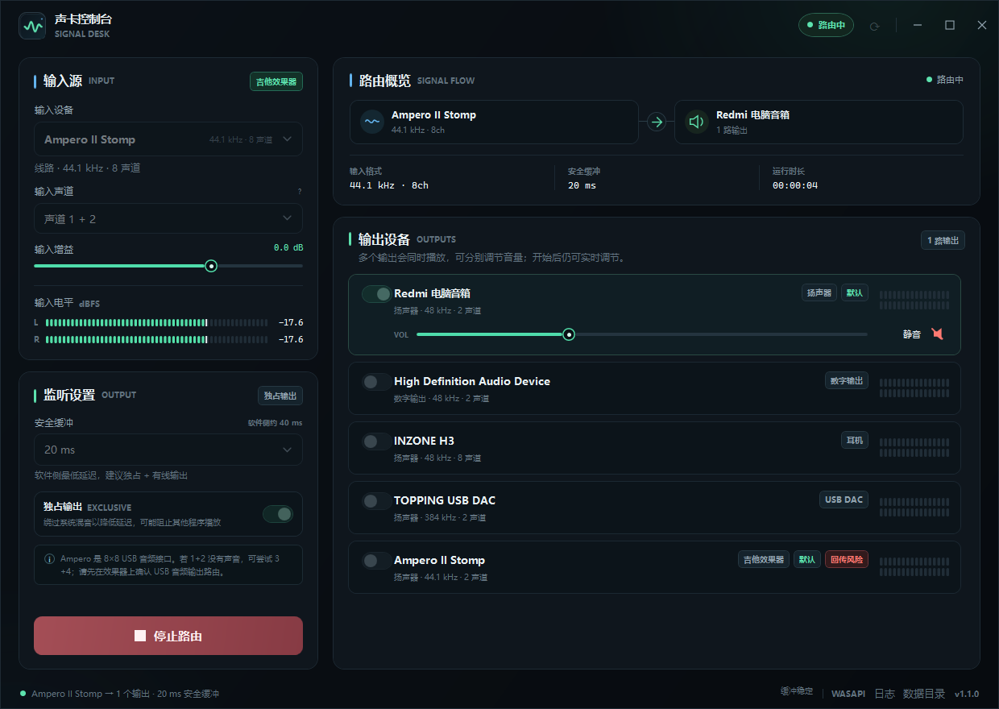

<p align="center">
  
</p>

<h1 align="center">Sound Console <sub>Signal Desk</sub></h1>

<p align="center">
  A focused Windows audio-routing console for guitar modellers, USB audio interfaces, and everyday audio devices.
</p>

<p align="center">
  <a href="https://github.com/MungRed/sound-console/actions/workflows/ci.yml"></a>
  <a href="https://github.com/MungRed/sound-console/releases/latest"></a>
  <a href="LICENSE"></a>
  <a href="https://dotnet.microsoft.com/"></a>
  <a href="#requirements"></a>
</p>

<p align="center">
  <a href="README.zh-CN.md">简体中文</a> ·
  <a href="https://github.com/MungRed/sound-console/releases/latest">Download</a> ·
  <a href="docs/ARCHITECTURE.md">Architecture</a> ·
  <a href="docs/BUILDING.md">Building</a> ·
  <a href="docs/TROUBLESHOOTING.md">Troubleshooting</a>
</p>

---

Sound Console routes the audio input of a USB audio interface — such as the **Hotone Ampero II Stomp** — to any Windows playback device: headphones, speakers, a USB DAC, or a virtual audio cable. It can fan out to several outputs at once, and shared-mode output keeps normal system audio playing alongside your instrument.

The interface is currently Chinese-first. English UI localization is a welcome contribution.



## Why this exists

Most guitar modellers expose a USB audio interface, but Windows does not provide a convenient way to send that input to an arbitrary playback device with gain, channel selection, metering, and multi-output control. Existing tools are either tied to a DAW, require ASIO, or hide routing behind a mixer application.

Sound Console is a small, self-contained WASAPI router built specifically for this workflow:

- Effect processor → USB → PC → headphones / speakers / DAC / virtual cable.
- Shared output mixes your instrument with normal desktop audio.
- Exclusive output is available when lower latency matters.
- Long-running sessions stay in sync through per-output clock-drift correction.

## Features

- **Input/output management** — enumerates active WASAPI capture and render endpoints; remembers your choices.
- **Ampero-aware defaults** — detects Ampero devices, selects them as input, and never auto-selects the effect processor as an output.
- **Channel-pair picker** — supports multi-channel interfaces; 8-channel devices expose `1+2`, `3+4`, `5+6`, `7+8`.
- **Multiple outputs** — route one input to up to eight playback devices, each with independent volume, mute, and level meter.
- **Input gain and metering** — −24 to +12 dB in 0.5 dB steps, stereo peak meters, and a latched clip indicator.
- **Latency presets** — 20, 30, 40, 60, 100, or 160 ms safety buffer. The 20/30 ms settings also request a shorter 10 ms WASAPI render buffer; 40 ms remains the default.
- **Shared and exclusive modes** — automatic fallback to shared mode when a device rejects exclusive access.
- **Clock-drift tolerant** — a shared ring buffer plus cubic interpolation keeps independent capture/render clocks from accumulating delay; a 60-second soak test with a 44.1 kHz input and 96 kHz stream completed with zero dropouts.
- **Desktop conveniences** — hot-plug detection, `F5` refresh, `Ctrl+Enter` start/stop, persistent settings, single-instance guard, error toast, and logs.
- **No telemetry** — the application does not make network requests and does not record audio.

## Requirements

- Windows 10 or Windows 11, x64.
- A WASAPI-compatible USB audio interface (tested with Ampero II Stomp).
- **The downloadable release is self-contained**: no .NET runtime installation or administrator rights are required.
- Building from source requires the **.NET 10 SDK** and PowerShell.

## Quick start

1. Download the latest `SoundConsole-*-win-x64.zip` from [Releases](https://github.com/MungRed/sound-console/releases/latest) and extract it.
2. Connect the Ampero over USB and make sure its USB audio output is enabled.
3. Run `声卡控制台.exe` (Sound Console).
4. Choose **Ampero II Stomp** as the input device and start with channel pair **1 + 2**.
5. Tick the playback device you want to hear — for example a USB DAC, headphones, or speakers. Multiple outputs are allowed.
6. Press **开始路由** (Start routing), then play. Keep peaks around −12 dBFS and lower the input gain if the `CLIP` badge appears.

> Device selection, channel mapping, buffer size, and output mode are locked while routing. Input gain, per-output volume, and mute remain live. Stop routing before changing devices.

### Choosing Ampero channels

An Ampero II Stomp exposes an 8-in/8-out USB interface. Channel mapping depends on the firmware and the USB-audio routing inside the effect processor:

- **1 + 2** is usually the processed main output.
- If that pair is silent, try **3 + 4**, **5 + 6**, then **7 + 8**.
- Confirm the USB Audio output level and routing on the Ampero itself.

### Shared vs. exclusive output

| Mode | Behaviour | Best for |
| --- | --- | --- |
| Shared (default) | The device stays available to Windows and other applications. System audio is mixed with the routed instrument. | Everyday monitoring, videos, streaming, virtual cables |
| Exclusive | Bypasses the Windows mixer for lower latency; other applications may lose access to the device. | Low-latency monitoring on a dedicated output |

If a device does not support exclusive mode, Sound Console automatically falls back to shared mode and shows a note. No audio path is left half-open.

### Latency guidance

Latency is made up of several layers:

```text
Ampero A/D + processing + USB transport
  + WASAPI capture period
  + Sound Console safety buffer
  + WASAPI render buffer + device/DAC buffering
  = what you hear
```

The application can control only the middle layers. The buffer tooltip shows a software-side estimate:

| Safety buffer | Render buffer | Software-side estimate* | Typical use |
| --- | --- | --- | --- |
| 20 ms | 10 ms | ~40 ms | Low-latency wired monitoring, exclusive mode |
| 30 ms | 10 ms | ~50 ms | Low-latency fallback |
| 40 ms (default) | 20 ms | ~70 ms | Shared-mode daily use |
| 60–160 ms | 20 ms | 90–190 ms | Bluetooth, virtual cables, maximum stability |

\* Capture period (~10 ms) + safety buffer + requested render buffer. This is **not** a measured round-trip: USB transport, the effect processor, and the output device add further latency.

For the lowest practical latency:

1. Select **20 ms**.
2. Enable **exclusive output**.
3. Use a wired USB DAC/headphone output, ideally at 44.1 or 48 kHz.
4. Stop other high-CPU/audio applications and avoid USB hubs.
5. If you hear dropouts, move to 30 ms, then 40 ms.

On the tested setup, the 20 ms + exclusive combination removes roughly 30 ms of software buffering compared with the 40 ms shared default. Expect a typical total around 50–70 ms with the modeller and hardware included — better for practice and streaming, but still not zero-latency monitoring.

This application is a PC-side router, not a zero-latency hardware monitor. For the tightest playing feel, use the modeller's direct monitoring or a dedicated ASIO interface.

### Sending audio to OBS, a DAW, or a meeting app

Windows does not expose a playback device as another application's microphone. Install a virtual audio cable (for example [VB-CABLE](https://vb-audio.com/Cable/) or VoiceMeeter), select the cable's **playback** end as a Sound Console output, then choose the cable's **recording** end in OBS/DAW/meeting software. You can keep a real headphone output enabled at the same time for local monitoring.

## Build, test, and package

```powershell
dotnet restore
dotnet build SoundConsole.sln -c Release
dotnet test SoundConsole.sln -c Release

# Produces a self-contained single-file build under dist\声卡控制台-win-x64
./build.ps1
```

The solution contains a WPF application (`src/SoundConsole`), a hardware-independent core library (`src/SoundConsole.Core`), and xUnit tests (`tests/SoundConsole.Core.Tests`). See [docs/BUILDING.md](docs/BUILDING.md) for prerequisites, publish options, and release steps.

### Project layout

```text
src/
  SoundConsole/             WPF UI, view models, custom meter control, themes
  SoundConsole.Core/        WASAPI devices, capture/render engine, DSP, settings
tests/
  SoundConsole.Core.Tests/  Hardware-free unit tests for DSP, parsing, settings
docs/                       Architecture, build, troubleshooting, screenshots
.github/                    CI, release workflow, issue and PR templates
```

## How it works

```text
WASAPI capture (e.g. Ampero 44.1 kHz / 8 ch)
        │  selected channel pair + input gain
        ▼
shared stereo ring buffer (2 s capacity, thread-safe)
        │  per-output cubic interpolation + drift correction
        ├──────────────► WASAPI shared render (48/96 kHz stream)
        ├──────────────► WASAPI exclusive render (44.1/48/96 kHz)
        └──────────────► virtual cable playback endpoint
```

Each output owns its read position and adapts the resampling ratio by a fraction of a percent to keep the shared buffer near the requested fill level. This avoids both unbounded latency growth and periodic hard resets. The engine does not use ASIO and does not install drivers. More detail: [docs/ARCHITECTURE.md](docs/ARCHITECTURE.md).

## Configuration and logs

- Settings: `%LOCALAPPDATA%\SoundConsole\settings.json`
- Logs: `%LOCALAPPDATA%\SoundConsole\logs\`
- The footer buttons **日志** and **数据目录** open them directly.
- Corrupt settings are backed up before defaults are restored.

No audio is stored. Logs contain device names and error details only.

## Troubleshooting

Start with the in-app **input level meter**:

- `−∞` means the PC is not receiving Ampero USB audio. Check the USB cable, the effect processor's USB Audio setting, and its output routing.
- Signal present but no sound: check the selected output, per-output mute, and the Windows volume for that endpoint.
- `CLIP`: lower input gain or the effect processor output.
- Exclusive mode rejected: use shared mode, or close applications that hold the device.

The full guide covers channel mapping, device fallback, virtual cables, log collection, and known limitations: [docs/TROUBLESHOOTING.md](docs/TROUBLESHOOTING.md).

## Limitations

- Windows only; built on WPF, WASAPI, and [NAudio](https://github.com/naudio/NAudio).
- No ASIO driver, no built-in virtual audio device, no audio recording, no effects processing.
- Multi-output streams are independently clocked, so they are not sample-aligned monitoring buses.
- The UI is Chinese-first; localization contributions are welcome.
- Bluetooth/virtual endpoints can add substantial latency.

Sound Console is not affiliated with Hotone, Ampero, Sony, TOPPING, or any hardware vendor. Product names are used only to describe compatibility.

## Contributing

Bug reports, hardware compatibility results, documentation improvements, and translations are welcome.

- Read [CONTRIBUTING.md](CONTRIBUTING.md) before opening a pull request.
- Use the issue templates for reproducible bugs and feature requests.
- Run `dotnet test SoundConsole.sln -c Release` before submitting.
- Report security issues privately according to [SECURITY.md](SECURITY.md).

## License

Released under the [MIT License](LICENSE). Third-party notices are listed in [THIRD-PARTY-NOTICES.md](THIRD-PARTY-NOTICES.md).

If this project is useful to you, a star or a tested-device report helps other musicians find it.
